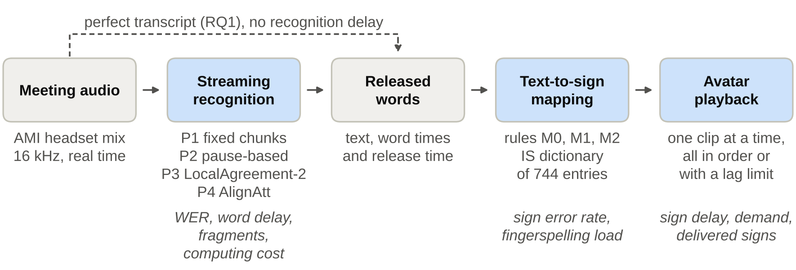
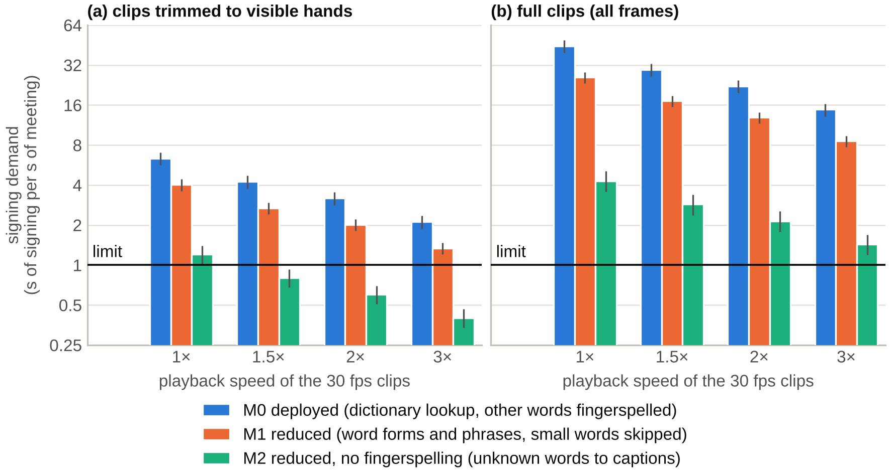
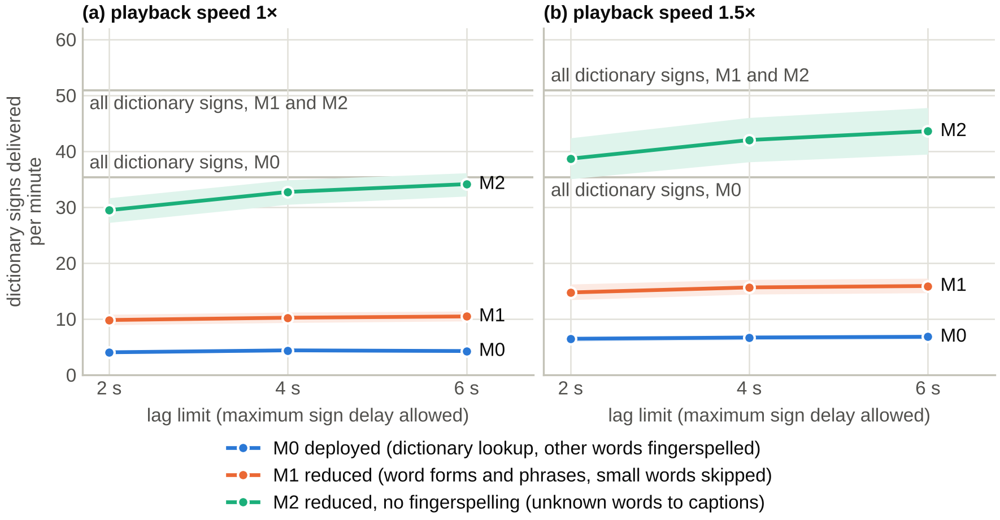
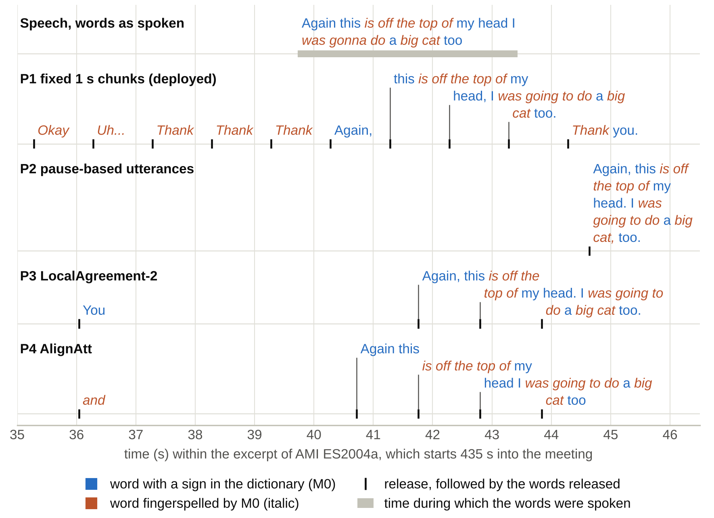
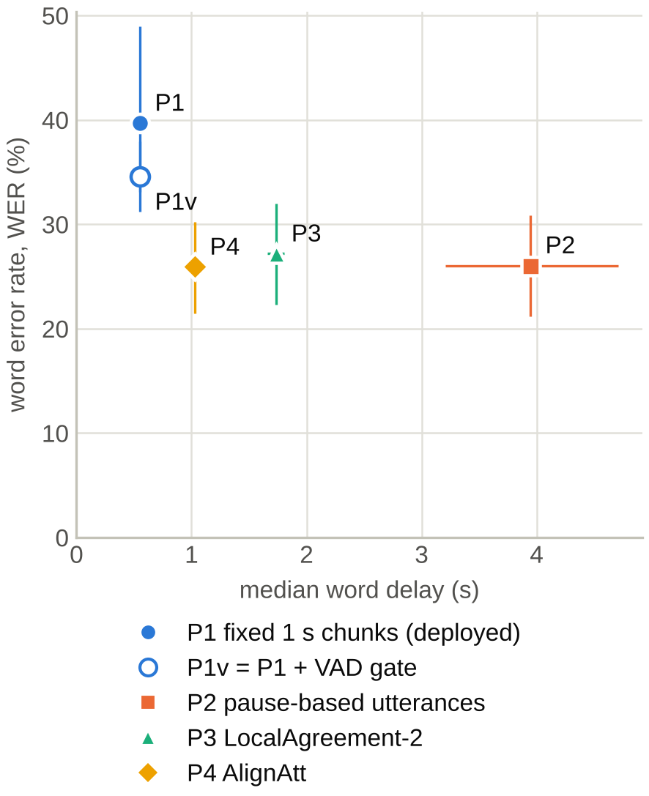
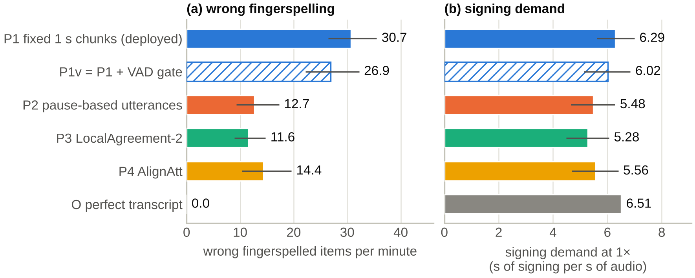
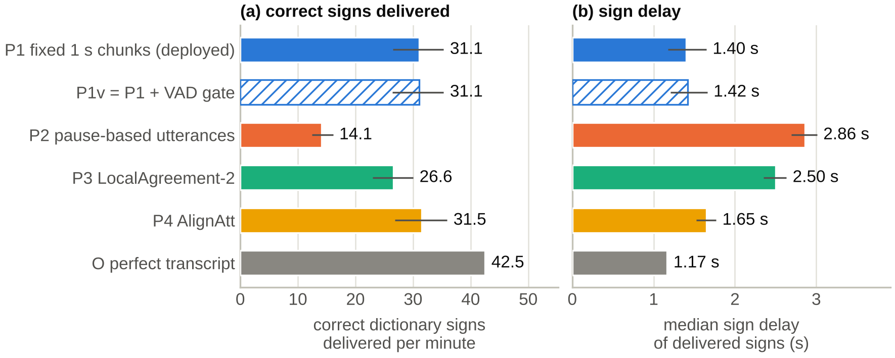

# Title

How live transcription shapes a signing avatar: an open benchmark of streaming speech recognition for real-time International Sign translation in meetings

# Authors and affiliations

Nikolaos D. Tantaroudas^1\*^, Andrew J. McCracken^2^, Ilias Karachalios^3^

^1^Institute of Communication and Computer Systems (ICCS), Iroon Polytechneiou 9, 15773, Zografou, Athens, Greece

^2^DASKALOS-APPS, 183 Rue de l'Abbé Griffon, 01960 Péronnas, France

^3^University of Thessaly, 413 34 Larissa, Greece

\*Corresponding author: <nikolaos.tantaroudas@iccs.gr>

# Abstract

**Background**

Live speech-to-sign systems such as INTERACT turn speech into text and show it as sign language performed by a three-dimensional avatar. Streaming speech recognisers are judged by error rate and delay, but their effect on the signing is unmeasured.

**Methods**

An open benchmark links streaming speech recognition, the INTERACT text-to-sign rules and an avatar model that plays one sign at a time. Perfect transcripts of 16 recorded business meetings (about nine hours) were mapped with three text-to-sign rules. A three-minute excerpt of each meeting was then replayed through four streaming methods (fixed chunks, pause-based utterances, LocalAgreement-2 and AlignAtt) with Whisper small, scoring text, signs and timing.

**Results**

With a perfect transcript, under a quarter of the words had a sign, and the deployed rule asked for over six seconds of signing per second of meeting. The avatar kept up only if unknown words went to captions and signs played faster. Fixed one-second chunks, the INTERACT setting, released words soonest but made the most errors, with over twice the others' wrong fingerspelling and a "thank you" invented in pauses. Pause-based utterances were accurate but arrived late and in bursts, so many signs were skipped. With lighter rules, faster playback and a limit on sign delay, AlignAtt delivered as many correct signs as the fixed chunks with about half as many wrong ones.

**Conclusions**

The avatar's signing speed, not the recogniser's delay, is the main bottleneck. Within it, the release of words decides how many correct signs arrive in time, which the word error rate misses, although it tracks the wrong signs. An early-releasing method such as AlignAtt, with voice activity detection, suits a signing avatar best.

# Keywords

streaming speech recognition, Whisper, simultaneous policy, sign language avatar, International Sign, fingerspelling, latency, accessibility

# Plain language summary

Some systems help deaf people follow a spoken meeting by turning speech into text and then into sign language performed by an animated character, an avatar. To work live, the speech recogniser must decide how long to listen before it writes words down. This study built a free, repeatable test of what then reaches the avatar. Even a perfect transcript of business meetings asks the avatar studied here to sign far more than it can, because most words have no sign in its dictionary and must be spelled out letter by letter. Then 48 minutes of the recordings were replayed through four common ways of doing live transcription. Cutting the speech into one-second pieces made the most mistakes and even wrote "thank you" during pauses, so the avatar would spell out "thank" although nobody had said it. Waiting for pauses gave accurate text that arrived late and all at once. AlignAtt, a method that confirms words while the speaker is still talking, gave as many correct signs in time as the one-second pieces, with about half as many wrong ones. Skipping unknown words, playing signs faster and dropping signs that would come too late keep the avatar close to the speaker.

# Introduction

Video meetings remain hard to follow for deaf and hard-of-hearing participants when no interpreter or captioner is available [@kushalnagar2014; @kawas2016]. INTERACT, an extended reality meeting platform built under the CORTEX2 Horizon Europe programme, addresses this by passing the speech through Whisper speech recognition [@radford2023] and translation to a 3D avatar that performs International Sign (IS) with clips extracted from dictionary videos with MediaPipe [@tantaroudas2026salento; @tantaroudas2026ore; @tantaroudas2026arxiv_interact; @lugaresi2019]. The same services support language learning in immersive settings [@tantaroudas2026salento2; @tantaroudas2026ore2; @tantaroudas2026arxiv_modular]. Pilot users rated the system highly but asked for adjustable signing speed, replay and richer facial expression [@tantaroudas2026ore]. INTERACT transcribes the speech in short pieces of one second that overlap with their neighbours, a setting chosen by trial because shorter pieces split words and longer ones slowed the system, although words are still sometimes cut at the edges of the pieces [@tantaroudas2026ore]. During development it was also noticed that the pause-based transcription of the CORTEX2 Mediation Gateway held the signing back until the speaker paused, and the way speech is cut into segments is known to have a strong effect on speech translation [@tsiamas2022].

Streaming speech recognition with models such as Whisper, which were built to transcribe complete pieces of recorded audio rather than a live stream, must decide again and again which of the words heard so far are safe to release. The simplest methods transcribe fixed pieces of audio or wait for pauses. LocalAgreement transcribes a growing stretch of audio repeatedly and releases the words on which two successive attempts agree [@liu2020; @polak2022], and it is the basis of Whisper-Streaming, which reported delays of a few seconds on long European Parliament speeches [@machacek2023]. Attention-guided methods such as EDAtt and AlignAtt use the recogniser's internal attention to judge which words are safe [@papi2023edatt; @papi2023alignatt]. Applied to Whisper, AlignAtt loses little accuracy even with one-second chunks, and the same work showed that words cut at chunk edges harm the recognition [@wang2024]. AlignAtt also underlies SimulStreaming, the system of Charles University for the simultaneous speech translation task of IWSLT 2025 [@machacek2025]. In addition, Whisper is known to write fluent text where there is no speech [@baranski2025; @koenecke2024]. Streaming methods are normally compared by their word error rate and their delay.

A signing avatar, however, uses the transcript differently from a person reading captions. For a dictionary lookup, a fragment such as "meet" for "meeting" is not a near miss but a wrong sign or, more often, a word spelled out letter by letter, which is called fingerspelling. An avatar that plays one clip at a time turns a burst of words into a queue. Signing also takes longer per item than speaking, because a sign takes longer to produce than a spoken word, although whole statements take about the same time [@bellugi1972], and fingerspelling, a noticeable part of everyday signing in American Sign Language [@padden2003], needs one hand shape per letter. Research on captions has shown that the word error rate is a poor guide to what deaf users experience [@kafle2017], and for avatars this question has, to the authors' knowledge, not been studied.

Research on sign language production has moved from phrase lookup to neural generation [@bragg2019; @rastgoo2021; @saunders2020]. TESSA translated a post office clerk's speech into British Sign Language in a narrow domain [@cox2002], later avatars were driven by linguistic models of sign notation [@elliott2008; @ebling2016], and recent systems join 3D signs retrieved from a dictionary of glosses [@zuo2024], provide an open-source baseline that looks up glosses and poses [@moryossef2023] or aim for very short delays with a streaming speech front end [@li2025]. Pipelines built from a dictionary of clips suit languages with few resources, such as IS, a flexible contact variety rather than a standardised national language [@hiddinga2011]. For an IS avatar with a dictionary of several hundred signs, companion studies measured what rewording English text into words that have a sign saves in fingerspelling and costs in meaning [@tantaroudas2026pp_rewriting], and how text in Greek, French, Spanish and German is best turned into English that such an avatar can sign [@tantaroudas2026pp_translate]. Deaf organisations warn, however, that replacing words with signs is not translation, especially for live, complex content [@wfd2018], and research on language technology argues that signed languages must be treated as languages in their own right [@yin2021]. Studies with deaf users have examined the acceptance, comprehensibility and naturalness of avatars [@kipp2011; @wasserroth2025], but the effects of live operation have rarely been measured.

This preliminary study asks how the settings of live transcription affect the signing, through four research questions:

- **RQ1 (dictionary and avatar):** With a perfect transcript that arrives without delay, how much signing does the sign dictionary used here require in natural meetings with several speakers, and can an avatar that plays one clip at a time keep up?
- **RQ2 (transcript):** How do four streaming methods trade the quality of the transcript against delay and computing cost?
- **RQ3 (from errors to signs):** How do the typical errors of streaming, such as cut words, repeated words and text written during silence, turn into wrong signs and unwanted fingerspelling?
- **RQ4 (end to end):** Which combination of streaming method, mapping rule and playback rule delivers the most correct signs within a set delay?

The contributions are:

1. an open, repeatable benchmark that connects real streaming recognisers to a text-to-sign mapping and an avatar model in a virtual-clock simulation,
2. an analysis of how much meeting speech the IS dictionary covers and how much signing it requires, with a ranked list of the most important missing signs,
3. a controlled comparison of four streaming methods on 16 meeting excerpts, scored against a perfect transcript of the same audio,
4. design recommendations for real-time speech-to-sign avatars.

A shorter version of this study, with the same data and main results, has been posted as a preprint [@tantaroudas2026pp_streaming].

The study extends the authors' earlier platform papers and preprints [@tantaroudas2026salento; @tantaroudas2026ore; @tantaroudas2026arxiv_interact] with a systematic evaluation of the live pipeline on a meeting corpus, and it involves no new human participants.

# Methods

## Overview

The benchmark follows the speech through the system. A streaming method decides when to run the recogniser and which words to release, and every released word keeps its text, the time at which it was spoken and its release time. A mapping rule turns each group of released words into sign items, which are dictionary signs, fingerspelled words or words left to the captions, and an avatar model plays the items one after the other. A second path uses the perfect, hand-made transcript without any recognition delay. This perfect-transcript analysis covers the full meetings and shows what the dictionary and the avatar allow on their own (RQ1), while the streaming experiment covers one excerpt per meeting and measures what the recogniser adds (RQ2 to RQ4). The code, the run files and the results of the benchmark are openly available on GitHub and archived on Zenodo [@zenodo_s2sbench].

Figure 1 shows these stages from left to right, with the settings compared below each box and the measures taken at each stage in italics.

**Figure 1. The benchmark pipeline, from meeting audio to avatar playback.** A streaming method releases time-stamped words, a mapping rule turns them into sign items for the International Sign (IS) dictionary, and an avatar model plays the clips one at a time. The settings compared are listed under each stage, and the measures taken at each stage are in italics. The dashed path replaces the recogniser with the manual transcript of the AMI Meeting Corpus, for the perfect-transcript analysis of research question 1 (RQ1). P1 to P4 are the streaming methods, M0 to M2 the mapping rules and WER the word error rate.

## Meeting data

This study used the official speech recognition evaluation set of the AMI Meeting Corpus, which is released under a CC BY 4.0 licence [@carletta2006; @amisets]. It has 16 meetings with three or four speakers each, mostly role-played design meetings and a few real meetings (Table 1). The input was the headset mix of the speakers' microphones, which resembles the clean audio of an online meeting, and the perfect transcripts come from the manual AMI word alignment, which gives every word a start and an end time. Punctuation and cut-off words were removed, and so were hesitations and back-channels such as "uh" or "mm-hmm", because they carry no content and Whisper usually leaves them out. Overlapping speech follows the AMI speaker segments in the order of their start times. No setting was tuned on these data. For the streaming experiment, one three-minute excerpt was taken from the middle of each meeting, by a rule fixed before any run. Table 2 gives the details of the preparation.

**Table 1.** The meeting data (AMI evaluation set for speech recognition, after removal of hesitations and cut-off words). Words per minute count all meeting time, silences included, and the last column gives the share of words that the deployed exact lookup finds in the dictionary (averaged over the meetings of a series, and over all words in the last row).

{{TABLE:dataset4}}

**Table 2.** Preparation of the data.

{{TABLE:dataprep}}

## The sign dictionary

The sign dictionary used in this study consists of MediaPipe landmark sequences, the positions of the body and hands in every frame, extracted from IS dictionary videos [@lugaresi2019; @tantaroudas2026arxiv_modular; @zenodo_isl]. As in the deployed system, each file is looked up by its file name in lower case [@tantaroudas2026ore]. A few files differ only in upper and lower case and share one entry, and a few entries carry a qualifier such as "I (not letter)" that a single-word lookup can never reach (Table 3). Each file covers the whole video, including frames before and after the hands are visible, so two clip lengths are used at the extraction rate of 30 frames per second [@tantaroudas2026ore]: the part with visible hands, which favours the avatar and is the default, and the full clip. Faster playback is expressed as a playback speed, such as 1.5×.

**Table 3.** Properties of the IS dictionary used in this study that matter for live use. IQR is the interquartile range.

{{TABLE:lexicon4}}

## Three mapping rules

Three mapping rules turn the same released words into sign items (Table 4). M0 reproduces the deployed INTERACT rule [@tantaroudas2026ore], which signs a word found in the dictionary and fingerspells any other word. M1 is a transparent rule for lowering the load, not a translation. It matches multi-word entries, maps common words to existing signs (for example "yeah" to YES), falls back to base forms found with the Simplemma lemmatiser [@simplemma], splits contractions and skips small function words without a sign, and it fingerspells what remains. M2 is M1 with the remaining unknown words left to the captions. No rule waits for future words, so mapping adds no delay. Word pieces that the AlignAtt method (P4, described below) releases separately are first joined into whole words, and sound descriptions such as "[BLANK_AUDIO]" are removed, as Whisper's text normaliser does.

**Table 4.** The three mapping rules.

| Rule | Dictionary lookup | Words without a sign | Small function words | Purpose |
|---|---|---|---|---|
| M0 deployed | exact lower-case word | fingerspelled | fingerspelled if not in the dictionary | reproduces INTERACT |
| M1 reduced | 19 aliases (for example yeah to YES, okay to OK, one to 1, the pronoun I to "I (not letter)"), base forms, multi-word entries within a group of released words, contractions split (don't to do not, can't to can not, with 's, 're, 'm, 've, 'll and 'd skipped) | fingerspelled | skipped if not in the dictionary (list of 89 function words and discourse particles) | lighter signing load |
| M2 no fingerspelling | as M1 | left to the captions | skipped if not in the dictionary | lightest signing load |

*Note:* Fingerspelling uses number signs for the digits 1 to 9 and the letter O for 0. Multi-word entries other than the alias for the pronoun "I" make up about 0.5% of the sign items of M1, so a phrase split between two groups of released words has a negligible effect.

## The avatar model

The avatar plays one clip at a time. A sign becomes available when its last word is released and starts when the avatar is free, a fingerspelled word lasts as long as its letter clips together, and no time is added for transitions, which favours the avatar. Two playback rules are compared. The first plays every item in order, however late, as INTERACT does. The second sets a lag limit and skips any item that, at the moment it could start, is more than the limit behind the end of its word as timed by the recogniser, leaving the word in the captions. The load is summarised by the signing demand, the seconds of signing requested per second of meeting. Like a queue at a single checkout, the avatar falls further and further behind when the demand is above one, and as the demand approaches one the backlog grows quickly, with a proportionally longer wait by Little's law [@little1961].

## Four streaming methods

All methods use the same recogniser, Whisper small [@radford2023], with English as the input language (Table 5). INTERACT uses the larger Whisper large-v2 on a graphics processor [@tantaroudas2026ore], but the experiment ran on ordinary processors, a choice discussed in the Limitations. P1 and P2 are implementations written for this study around faster-whisper [@fasterwhisper] with the decoding settings of Whisper-Streaming [@machacek2023], and they transcribe each piece of audio on its own.

- **P1, fixed chunks,** is the deployed setting [@tantaroudas2026ore]. It transcribes every one-second window with a little extra audio on each side, keeps the words in the middle of each window and also transcribes windows without speech.
- **P2, pause-based utterances,** imitates the pause-based transcription of the Mediation Gateway, which is not public. A voice activity detector (VAD), a small model that detects speech [@silero2024], splits the audio into utterances, and each utterance is transcribed when it ends.
- **P3, LocalAgreement-2,** from Whisper-Streaming [@machacek2023], transcribes a growing buffer again and again and releases the longest beginning on which two successive attempts agree [@liu2020; @polak2022]. At the end of each stretch of speech it releases its last unconfirmed guess without transcribing the audio received since the previous attempt, a behaviour that was kept.
- **P4, AlignAtt,** from SimulStreaming [@papi2023alignatt; @wang2024; @machacek2025], releases the words that the recogniser's attention marks as safe.

A fifth variant, P1v, is P1 with a VAD gate that skips windows without speech. Because P1 transcribes every window independently, P1v gives exactly the words of P1 for the windows it keeps, so it was derived from the P1 runs and is compared only with P1. P3 and P4 use the reference code unchanged. P1 to P3 run with compact 8-bit integer weights, whereas P4 needs 32-bit floating point in PyTorch, so its computing cost is not directly comparable with the others.

**Table 5.** The streaming methods and the derived variant P1v, all with Whisper small.

| ID | Method | How it releases words | Main settings | Implementation |
|---|---|---|---|---|
| P1 | fixed chunks (deployed) | transcribes every window and releases its words at once | 1 s windows with 0.25 s of extra audio on each side (1.5 s windows overlapping by 0.5 s), words kept by their midpoint, no VAD | custom code, faster-whisper (8-bit integer) |
| P1v | fixed chunks with VAD gate | as P1, but windows without detected speech are skipped | as P1, Silero VAD with the settings of P2 | derived exactly from the P1 runs, computing cost is the measured cost of the kept windows plus the VAD |
| P2 | pause-based utterances | transcribes each utterance once the speaker pauses | Silero VAD with threshold 0.5, 500 ms of silence ends an utterance, 100 ms padding, utterances cut at 15 s | custom code, faster-whisper (8-bit integer) |
| P3 | LocalAgreement-2 | transcribes a growing buffer again and again and releases the words that two successive attempts agree on | new attempt after at least 1 s of audio, VAD control, buffer trimmed at 15 s, prompt of up to 200 characters of released text | Whisper-Streaming [@machacek2023], faster-whisper (8-bit integer) |
| P4 | AlignAtt | releases the words that the recogniser's attention marks as safe | new attempt after at least 1 s of audio, VAD control, frame threshold 25, greedy decoding, Simul-Whisper end-of-word detector | SimulStreaming [@machacek2025], PyTorch (32-bit floating point) |

*Note:* P1 and P2 use beam size 5 and word timestamps, as the Whisper-Streaming back end does, without a text prompt, and all other faster-whisper options, including the no-speech and log-probability thresholds and the temperature fallback, are left at their defaults. P3 and P4 run the reference code at fixed versions.

## Simulation

A virtual clock reproduced live operation. Audio arrives in real time in small packets, and the clock stops while the recogniser runs, so every word is stamped with the moment at which the method had all the audio it used. This mode without computing time, which Whisper-Streaming and SimulStreaming provide [@machacek2023; @machacek2025] and the SimulEval toolkit calls non-computation-aware [@ma2020simuleval], gives the delays caused by the methods themselves, the lower limit that fast enough hardware approaches, independently of the computer used. Computing cost was measured separately. Table 6 lists the settings of the simulation, including the playback speeds and lag limits of the avatar model, and the result of a repeatability check. In that check three methods reproduced their output exactly, and P1 differed in a few words, because faster-whisper decodes a failed short window again with random sampling, so the same short window can give "Thank you." in one run and different words, or none, in another.

**Table 6.** Simulation set-up, computer and repeatability check.

{{TABLE:simsetup}}

## What was measured

Table 7 explains the measures in plain terms. They were computed for each excerpt in the streaming experiment and for each meeting in the perfect-transcript analysis, and the sign and avatar measures were also computed for the perfect transcript of each excerpt, shown as row O in the tables. Meetings are the unit of analysis. Averages are given with 95% bootstrap confidence intervals [@efron1979], and the four methods are compared with the Friedman test [@friedman1937] followed by pairwise Wilcoxon signed-rank tests [@wilcoxon1945] with Holm's correction [@holm1979], as is standard for comparing systems over several data sets [@demsar2006]. P1v is compared with P1 by a Wilcoxon test. Spearman correlations within meetings show whether transcript measures predict sign measures.

**Table 7.** The measures.

| Level | Measure | What it means |
|---|---|---|
| Transcript | Word error rate (WER) | substituted, deleted and inserted words divided by the number of reference words (it can exceed 100%), computed with JiWER [@jiwer] after Whisper's English text normaliser [@radford2023] over the whole excerpt |
| Transcript | Overlap-tolerant WER | a version of WER that allows for overlapping speakers (tcORC-WER, computed with MeetEval [@vonneumann2023] with a 5 s collar) |
| Timing | Word delay | for each correctly recognised word, the time from the end of the word in the reference transcript to its release (recogniser and reference times within 3 s), given as the median and the 90th percentile, a word-level version of the delay measures used in simultaneous translation [@ma2019] |
| Transcript | Fragments | words cut by the edge of a chunk, per 1,000 reference words: a wrong word that is the beginning or the end of a reference word of at least three letters, or two neighbouring words that together form it (a cautious count, because a cut word recognised as a different word is not counted) |
| Transcript | Repeated words | inserted words equal to a neighbouring word, per 1,000 reference words |
| Transcript | Words where nobody spoke | words more than 1 s away from any reference word, per hour, a sign of text invented in silence or noise [@baranski2025; @koenecke2024] |
| Computing | Real-time factor and calls | computing time divided by audio time on the test computer (above 1 means slower than real time), and recogniser calls per minute of audio |
| Sign | Sign error rate | how much the sign sequence made from the recogniser's text differs from that of the perfect transcript under the same mapping rule (edit distance divided by the length of the perfect sequence) |
| Sign | Wrong signs per minute | fingerspelled items or dictionary signs that are extra or different compared with the signs of the perfect transcript |
| Avatar | Signing demand | seconds of signing requested per second of audio |
| Avatar | Sign delay | for delivered signs that match a sign of the perfect transcript (times within 5 s), the time from the end of the word in the reference transcript to the start of the sign |
| Avatar | Correct signs delivered | correct dictionary signs actually played per minute |
| Statistics | Uncertainty | 95% percentile bootstrap confidence intervals over the 16 meetings, 10,000 resamples |
| Statistics | Comparisons | Friedman test over the four methods, then pairwise Wilcoxon signed-rank tests with Holm's correction over the six pairs |

## Perfect-transcript analysis

For RQ1, the manual transcript of each meeting was passed through the three mapping rules in one batch, with every item available as soon as its last word ended, and a constant recognition delay was tested as a check.

# Results

## RQ1: what the dictionary asks of the avatar

Even a perfect transcript asks far more of the avatar than it can deliver (Table 8). Fewer than a quarter of the spoken words have an entry in the dictionary, so under the deployed rule M0 most sign items are fingerspelled words, a share far above published estimates for natural signing, and the avatar has to spell hundreds of letters per minute. M1 removes about a third of the items, but almost half of the rest is still fingerspelled, and M2 moves those words to the captions.

**Table 8.** What a perfect transcript asks the avatar to sign (16 meetings, playback at 1×, clips trimmed to the part with visible hands unless stated otherwise, mean over meetings with 95% bootstrap confidence intervals).

{{TABLE:rq1load}}

*Note:* {{cov_tok_m0}}% of all word tokens, and on average {{cov_type_m0}}% of the different words in a meeting, have an entry in the dictionary under the exact lookup of M0. M2 fingerspells nothing, because it leaves words without a sign to the captions. For comparison, fingerspelling has been estimated at 12 to 35% of signed discourse in American Sign Language, and at about 10 to 15% on average [@padden2003].

Figure 2 shows the resulting signing demand for each mapping rule and playback speed, with clips trimmed to the part with visible hands (a) and played in full (b). Bars above the line at one ask for more signing than an avatar that plays one clip at a time can deliver.

**Figure 2. Signing demand of the three mapping rules with a perfect transcript.** Signing demand is the number of seconds of signing requested per second of meeting when a perfect transcript arrives without delay (AMI evaluation set, mean and 95% bootstrap confidence interval over 16 meetings, logarithmic scale). Values above the line at one cannot be sustained by an avatar that plays one clip at a time. Playback speeds are multiples of the 30 frames per second (fps) of the clips. (a) Clips trimmed to the part with visible hands. (b) Full clips.

The demand stays above one for M0 and M1 even at triple speed, playing whole clips multiplies it, and on average only M2 at 1.5× or faster falls below one (Table 9). Above one, the queue grows throughout the meeting, so with the deployed rule at normal speed the median sign comes more than an hour after it was spoken. The averages also hide differences between meetings, and in the fast-real meetings even M2 at 1.5× overloads the avatar (note to Table 9).

**Table 9.** Outcomes with a perfect transcript for each mapping rule and playback speed (clips trimmed to the part with visible hands, mean over 16 meetings). With all items played in order, the delays are medians over all delivered signs. The last three columns use a lag limit of 4 s, without and with a constant recognition delay of 2 s.

{{TABLE:rq1rates}}

*Note:* Meeting speed matters. For M2 at 1.5×, the four real meetings (EN series), which have the fastest speech, had a signing demand of {{en_rho_lo}} to {{en_rho_hi}} and median sign delays of {{en_lag_lo}} to {{en_lag_hi}} s, whereas the other twelve meetings had a demand of at most {{nonen_rho_hi}} and median sign delays of {{nonen_lag}} s on average.

Figure 3 shows how many dictionary signs a lag limit lets through for each mapping rule as the limit varies, at normal speed (a) and at 1.5× (b), with grey lines marking all the dictionary signs that are available.

**Figure 3. Dictionary signs delivered per minute under a lag limit, with a perfect transcript.** The signs delivered are shown as a function of the lag limit, the longest delay allowed before a sign starts, at normal speed (a) and at 1.5× (b), with clips trimmed to the part with visible hands and a perfect transcript that arrives without delay (mean and 95% bootstrap confidence interval over 16 meetings). Grey lines give all the dictionary signs available per minute under M0 and under M1 and M2.

A lag limit trades completeness for timeliness. With M2 at 1.5× and a four-second limit, most of the available dictionary signs get through, whereas under M1 and M0 the fingerspelled items keep the avatar busy and far fewer signs are delivered (Table 9). A recognition delay of two seconds changes this only a little. The missing vocabulary is concentrated in relatively few words (Table 10), many of them basic IS signs such as NOT, ALL, SOMETHING and THING, or recurring terms of the AMI design scenario such as REMOTE, BUTTON and DESIGN.

**Table 10.** The most frequent words without a dictionary entry under M0, and the most frequent words that M1 still fingerspells (all 16 meetings). The last two rows give the share of the fingerspelled words that the 100 and the 200 most frequent words account for.

{{TABLE:oov4}}

## RQ2: transcript quality, delay and computing cost

Figure 4 shows how the four methods release words during a short stretch of one excerpt. Each release is a tick, the words released together are written after it, and each word is coloured by what the deployed rule makes of it.

**Figure 4. Words released by the four streaming methods during 11.5 seconds of one meeting excerpt.** The stretch shown runs from 35 to 46.5 s in the excerpt of AMI meeting ES2004a (Whisper small, computing time not included). Top row: the words as spoken, with a grey bar for the time during which they were spoken. Each tick is a release, and the words released together are written after it. Releases whose words would overlap are stacked from top to bottom in the order of release. Blue words have a sign in the dictionary, and orange italic words are fingerspelled by the deployed rule M0.

This stretch begins just after a speaker says "okay". Nobody speaks for several seconds, and then a speaker says "again this is off the top of my head, I was gonna do a big cat too". During the pause P1 writes "Uh..." and then "Thank" in three windows in a row, and after the sentence it adds "Thank you.", so the deployed rule would fingerspell every THANK. P3 and P4 each write a single word in the pause. P2 releases the whole sentence at once, only after it has ended, while P3 and P4 release it in small groups as it is spoken, P4 about a second earlier than P3.

P2, P3 and P4 reached similar word error rates, whereas the deployed setting P1 made clearly more errors (Table 11), and the statistical tests, listed at the end of the Results, separated P1 from each of the others. Among the other three, only P3 and P4 differed, and only slightly. P2 to P4 mostly left words out, whereas P1 substituted and inserted many more words, often repeating them in consecutive windows or writing them where nobody spoke. Word fragments were rare for all four methods.

**Table 11.** Accuracy of the transcripts in the streaming experiment (Whisper small, mean over 16 excerpts, 95% bootstrap confidence interval in parentheses). The substituted, deleted and inserted words per 100 reference words add up to the WER.

{{TABLE:rq2acc}}

The VAD gate kept most of the windows of P1, removed almost all the words written where nobody spoke and lowered its word error rate (Table 12). Most of this gain came from the quietest excerpt, in which P1 wrote more words than had been spoken, and P1v remained less accurate than P2 to P4, probably because its windows with speech are still transcribed in short pieces without the words before them.

**Table 12.** Effect of the VAD gate on P1 (P1v compared with P1), and the quietest excerpt.

{{TABLE:vadgate}}

The methods differed most in when they released words (Table 13). P1 released words soonest, followed by P4 and P3, and P2, which waits for the end of each utterance, came last, with all pairs differing. P4 rarely held a word back for long, whereas P3 sometimes waited several seconds for two attempts to agree, and the slowest words of P2 waited much longer still.

**Table 13.** Word delay and computing cost of the streaming methods (mean over 16 excerpts, 95% bootstrap confidence interval in parentheses). Word delay is measured from the end of each correctly recognised word. Computing cost was measured on a virtual machine with two virtual processors.

{{TABLE:rq2delay}}

Figure 5 places each method by its median word delay on the horizontal axis and its word error rate on the vertical axis, so the best methods sit near the lower left corner.

**Figure 5. Delay and accuracy of the streaming methods.** Each method is placed by its median word delay and its word error rate (WER) with Whisper small, computing time not included. Points are means over 16 excerpts with 95% bootstrap confidence intervals. Methods near the lower left corner are both fast and accurate. P1v is P1 with a voice activity detection (VAD) gate, derived from the P1 runs.

The computing cost differed several-fold (Table 13). P2 transcribes each utterance only once and needed the least, while P1, P3 and P4 ran slower than real time on the small test computer, P4 partly because of its slower floating-point engine, and the VAD gate lowered the cost of P1 a little. A graphics processor runs Whisper far faster, so these numbers show the relative cost of the methods only.

## RQ3: from transcript errors to signing errors

Under the deployed rule M0, the signs made from the transcript of P1 had the highest sign error rate and more than twice as much wrong fingerspelling as those of P2 to P4 (Table 14). Deleted words produce no signs, so on average every method asked for less signing than the perfect transcript, with P1 closest to it, because its insertions made up for part of its deletions, and all these demands stayed far above one.

**Table 14.** Signs produced under the deployed rule M0 (all items played in order at 1×, mean over 16 excerpts, 95% bootstrap confidence interval in parentheses). Row O: perfect transcript of the same excerpts, without delay.

{{TABLE:rq3m0}}

*Note:* In {{p1_rho_above_O_n}} of the 16 excerpts, P1 asked for more signing than the perfect transcript.

The reduced rule M1 lowered the wrong fingerspelling for every method (Table 15), but its aliases turned more recognition errors into wrong dictionary signs, so that an inserted or misrecognised "yeah", for example, becomes YES.

**Table 15.** Signs produced under the reduced rule M1 (all items played in order at 1×, mean over 16 excerpts, 95% bootstrap confidence interval in parentheses).

{{TABLE:rq3m1}}

Most of the wrong fingerspelling of P1 did not come from cut words (Table 16). Its most frequent wrong items were a fingerspelled THANK and the sign YOU, the "thank you" that Whisper is known to write for audio without speech [@baranski2025], and these were far more common for P1 than for the other methods. Even so, most of the wrong fingerspelling of P1 arose within speech, from ordinary recognition errors, and only a small part came from words written where nobody spoke or from fragments of cut words, which is why the VAD gate removed only a modest share of it (Table 12).

**Table 16.** Where the wrong signs come from under the deployed rule M0 (all 16 excerpts). The last three columns split the wrong fingerspelled items per minute by their cause.

{{TABLE:spurcauses}}

Figure 6 compares the wrong fingerspelling (a) and the signing demand (b) of each method under the deployed rule, with the perfect transcript at the bottom.

**Figure 6. Wrong fingerspelling and signing demand of each streaming method under the deployed rule.** The results are for Whisper small with the deployed rule M0. (a) Wrong fingerspelled items per minute, that is, fingerspelled items that are extra or different compared with the signs of the perfect transcript. (b) Signing demand at normal speed, the seconds of signing requested per second of audio. Mean and 95% bootstrap confidence interval over 16 excerpts. O is the perfect transcript without delay, and P1v is P1 with a voice activity detection (VAD) gate.

## RQ4: sign delay and delivered signs

In the deployed configuration, which uses rule M0 and plays every item in order at normal speed, every method overloaded the avatar, which kept signing long after each three-minute excerpt had ended, and even with a perfect transcript the median sign came several minutes after it was spoken (Table 17). The queue, not the recogniser, set the delay, so transcripts that lost more words were signed sooner.

**Table 17.** The deployed configuration: rule M0 with all items played in order at 1× (mean over 16 excerpts). Because the queue keeps growing during an excerpt, these delays are lower limits for whole meetings (compare Table 9).

{{TABLE:rq4m0}}

With rule M2, playback at 1.5× and a four-second lag limit, the streaming method decides how much of the speech is signed (Table 18). P4 delivered about three quarters of the correct signs that the perfect transcript allows, with a short median sign delay. P1 delivered a similar number, but with about twice as many wrong dictionary signs as P4, P3 delivered fewer, and P2 only about a third of the number with the perfect transcript, because about half of its late and bunched items had passed the limit before the avatar could start them.

**Table 18.** End-to-end results with rule M2, playback at 1.5× and a lag limit of 4 s (mean over 16 excerpts, 95% bootstrap confidence interval in parentheses). Row O: perfect transcript of the same excerpts.

{{TABLE:rq4}}

*Note:* P4 delivered {{dlex_ratio_P4P2}} times as many correct signs as P2, although their word error rates were almost the same (Table 11).

Figure 7 shows, for this configuration, how many correct dictionary signs each method delivers (a) and how late they start (b).

**Figure 7. Correct signs delivered per minute and median sign delay of each streaming method.** The configuration is rule M2, playback at 1.5× and a lag limit of 4 s. (a) Correct dictionary signs delivered per minute. (b) Median sign delay of the delivered signs. Mean and 95% bootstrap confidence interval over 16 excerpts. O is the perfect transcript without delay, and P1v is P1 with a voice activity detection (VAD) gate.

The comparison between P1 and P4 depends on the playback rule (Table 19). With a tighter limit P1 delivered more correct signs, because its words arrive first, with a looser limit the two did not differ significantly, and with the four-second limit at normal speed P4 delivered more. P2 delivered the fewest at every limit.

**Table 19.** Correct dictionary signs delivered per minute for different lag limits and playback speeds (rule M2, mean over 16 excerpts). The last column compares P1 and P4 (Holm-adjusted Wilcoxon p).

{{TABLE:lagsens}}

The word error rate did not predict these outcomes. P2 and P4 had almost the same word error rate, but P4 delivered more than twice as many correct signs, and P1, the least accurate method, delivered as many correct signs as P4, together with the most wrong ones. Within meetings, the sign error rate followed the word error rate almost exactly, but the number of correct signs delivered was only weakly related to it, and the weak relation was even positive, because the least accurate method was also the fastest. The number of correct signs fell steeply, however, as the word delay grew (Table 20). Table 21 lists all the statistical tests.

**Table 20.** Spearman rank correlations within meetings between transcript measures and sign measures (over all combinations of the 16 excerpts and the four methods, after subtracting the average of each meeting).

{{TABLE:correl}}

**Table 21.** Friedman tests across the four methods and Holm-adjusted pairwise Wilcoxon signed-rank tests (16 meeting excerpts). Pairs with an adjusted p below 0.05 are in bold.

{{TABLE:stats4}}

# Discussion

## The avatar, not the recogniser, sets the pace

The perfect-transcript analysis shows that the throughput of an avatar built from a dictionary of clips is the first limit that a live speech-to-sign system meets in natural meetings. Ordinary meeting speech, with fewer than a quarter of its words in the dictionary and citation clips of almost two seconds, produces several seconds of signing for every second of meeting, and no streaming method can remove that backlog, because the recogniser only decides when items become available, not how long they take to play. The streaming experiment confirmed that, in the deployed configuration, the queue rather than the recogniser set the delay. This agrees with signs taking longer to produce than spoken words [@bellugi1972] and with the clips being isolated dictionary forms rather than signs produced in connected signing, and it may explain why the pilot users of INTERACT, who used the system in structured demonstration tasks, rated it highly yet asked for adjustable signing speed [@tantaroudas2026ore]. Three levers lower the demand:

- **Load reduction:** M1 removes about a third of the items and M2 about two thirds.
- **Faster playback:** trimming idle frames and speeding up the clips.
- **Admission control:** skipping items that would arrive too late.

Deaf organisations warn that avatars are least suitable for live, complex content [@wfd2018], and the present results quantify one reason, because without these levers the deployed design cannot follow spontaneous speech with several speakers. They also support keeping captions as a parallel channel, which M2 and the lag limit rely on, and whose design for deaf and hard-of-hearing users is an active research area in its own right [@kushalnagar2014; @pataca2024].

## How the streaming method matters

Within the throughput limit, two properties of a streaming method decide what the avatar signs, namely how many wrong words it writes, including words where nobody is speaking, and how early and how evenly it releases words. The word error rate reflects only the first.

The deployed fixed chunks release words fastest, but without a voice activity detector they also transcribe silence and background noise, which Whisper fills with fluent phrases such as "thank you" [@baranski2025; @koenecke2024]. Part of this output is random, because faster-whisper decodes a failed short window again with random sampling (see Simulation), and switching off this fallback for short windows may be a further cheap fix, which was not tested here. A caption reader can ignore a stray "thank you", but a dictionary-based avatar fingerspells THANK letter by letter and signs YOU, spending its scarce signing time on something nobody said. A VAD gate removes almost all the text written in silence and saves computing at no cost in delay, which makes it the cheapest improvement to the deployed system. It removed only a modest share of the wrong fingerspelling, however, because most errors of P1 occur within speech. P1 most likely substitutes and inserts so many words because each short window is transcribed without the words before it.

Pause-based utterances are accurate, but they reach the avatar whole, seconds after they began. This suits captions, which a reader can scan back, but not an avatar that must stay within a lag limit, because most of a long utterance is already too old when the avatar reaches it. The same mechanism fits the delay that was observed with the pause-based transcription of the Mediation Gateway during the development of INTERACT.

LocalAgreement-2 and AlignAtt both release words while the speaker talks and give clean, accurate transcripts, but AlignAtt releases them sooner and more evenly, whereas LocalAgreement occasionally waits several seconds for two attempts to agree, which under a lag limit means skipped signs. AlignAtt therefore delivered as many correct signs as the fixed chunks within a four-second limit at 1.5×, with about half as many wrong signs, and more than LocalAgreement-2 and pause-based utterances.

Recognition errors also lighten the load of the avatar, because deleted words produce no signs, but unlike deliberate load reduction this is uncontrolled, as what gets dropped depends on what the recogniser misses rather than on what matters least to the viewer.

Two methods with almost the same word error rate differed here by more than a factor of two in how much of the speech the avatar could sign. For speech-to-sign systems, this study therefore suggests evaluating streaming recognition by the correct signs delivered within a lag limit, the wrong signs and fingerspelling per minute and the slowest word delays, alongside the word error rate.

## Recommendations for real-time speech-to-sign avatars

Based on the perfect-transcript analysis and the streaming experiment, this study makes the following recommendations:

- **Prefer an incremental method that releases words early, with voice activity detection.** Within a four-second limit at 1.5×, AlignAtt gave as many correct signs as fixed one-second chunks with about half as many wrong ones. LocalAgreement-2 was almost as accurate, but its occasional long waits cost signs. If fixed chunks are kept, gate them with a VAD and filter the known invented phrases [@baranski2025].
- **Do not drive a signing avatar with pause-based utterances,** because their bursts conflict with any lag limit.
- **Treat the signing demand as a design budget and monitor it live.**
- **Trim clips to the part with visible hands and allow faster playback,** ideally with blending between clips.
- **Limit fingerspelling,** for example to proper names and short words, and send the remaining unknown words to the captions. Rewording is another option, since replacing each missing word by a similar word with a sign removed more than half of the fingerspelling at some cost in meaning [@tantaroudas2026pp_rewriting].
- **Use a lag limit,** so that the avatar never falls far behind the speaker.
- **Expand the dictionary in order of word frequency,** because a short list of frequent words accounts for a large share of the remaining fingerspelling in this domain (Table 10). The rewording study reached the same advice, because with a dictionary of the most frequent English words every method tested kept most of the meaning [@tantaroudas2026pp_rewriting].

These recommendations aim at timeliness. They do not turn word-by-word substitution into IS translation, which needs a model of IS grammar and the involvement of deaf signers [@bragg2019; @yin2021].

## Limitations

- **Sign quality is measured indirectly.** The sign error rate, wrong fingerspelling and sign delay are computed measures and do not show how well deaf IS users understand the signing. The delays that matter to users have still to be established for avatars. For real-time captions, a delay of less than five seconds has been set as a target [@kushalnagar2014], and among interpreters, those who lag less behind the speaker make more errors [@cokely1986].
- **A smaller recogniser and no hardware delay.** The experiment used Whisper small, whereas INTERACT uses Whisper large-v2 on an NVIDIA T4 graphics processor (AWS g4dn.xlarge) [@tantaroudas2026ore; @aws_g4], with which error rates are expected to be lower. The delays exclude computing time, which comes on top of them on real hardware, most of all for P1, which runs the recogniser every second, and for P2, whose utterances are transcribed only after they end. For comparison, INTERACT reported an average transcription delay of about a second from the start of speech to the text on screen [@tantaroudas2026ore]. The benchmark includes the configuration for repeating the experiment on a graphics processor with Whisper large-v2 and computing time included.
- **Excerpts rather than whole meetings.** The streaming experiment covers one three-minute excerpt per meeting, so its delays with every item played in order are lower limits for whole meetings, which the perfect-transcript analysis covers.
- **A simplified avatar model.** Clips are played at a constant speed, without interruption, blending or transition time, whereas real systems may blend, skip or interrupt clips. Network and rendering delays between the cloud services and the headset would add to every delay reported here.
- **P2 is an approximation** of the pause-based behaviour of the Mediation Gateway, not the gateway itself.
- **Computing costs are not fully comparable,** because P4 runs on a different engine with a different numerical precision, and the timings on an ordinary processor show relative cost only.
- **Reference implementations were used as released,** including the release by P3 of its last guess at the end of each stretch of speech.
- **One corpus and one language.** AMI is in English, with clean close-talk audio and a design-meeting scenario, which shapes the vocabulary and the most frequent missing signs. Speech in another language must first be translated into English for the dictionary. For written Greek and French sentences, translating as usual and rewording afterwards proved the better design [@tantaroudas2026pp_translate], but how streaming recognition in these languages affects the signing was not measured.
- **Simple mapping rules.** M1 and M2 are transparent rules chosen to limit the load, not linguistically validated IS translations.

## Future work

Future work will repeat the streaming experiment with Whisper large-v2 on the deployment graphics processor, with computing time included, and will extend it to whole meetings. Further planned steps are a user study with deaf IS users to calibrate the computed measures against comprehension and acceptability, the replacement of word lookup with constrained IS glossing by large language models, and the addition of clip blending and an adaptive playback speed to the avatar. Language models restricted to the words of the dictionary removed almost all fingerspelling but kept only part of the meaning [@tantaroudas2026pp_rewriting; @tantaroudas2026pp_translate], so such constraints will have to be judged on meaning as well as on signing load.

# Conclusions

This paper presented an open benchmark that measures how live speech recognition affects a real-time signing avatar and applied it to the INTERACT International Sign pipeline. With perfect transcripts of recorded business meetings, the deployed mapping of word lookup plus fingerspelling asks the avatar to sign far more than it can, and only load reduction, faster playback and a lag limit bring the signing close to the speaker. Within that limit, the streaming method matters in ways that the word error rate does not show. The deployed fixed one-second chunks, without a voice activity detector, produced more than twice as much wrong fingerspelling as the other three methods, mostly from recognition errors within speech, so a VAD gate removed only a small part of it. Pause-based utterances arrived too late and too bunched for an avatar with a lag limit. Within a four-second limit at 1.5×, AlignAtt delivered as many correct signs as the fixed chunks, about three quarters of the number possible with a perfect transcript, with about half as many wrong signs. Replacing fixed chunks with an early-releasing incremental method such as AlignAtt, together with voice activity detection, load reduction and a lag limit, is therefore the most direct improvement for INTERACT and similar systems. The benchmark and all results are openly available for evaluating other speech-to-sign systems.

# Ethics and consent

This study used only previously published, openly licensed data: the AMI Meeting Corpus (CC BY 4.0), whose recordings were collected with the consent of the participants by the AMI project [@carletta2006], and landmark data derived from public IS dictionary videos [@zenodo_isl]. No new data were collected from human participants, so ethical approval and consent were not required.

# Data and software availability

## Source data

- AMI Meeting Corpus, Mix-Headset audio and manual annotations release 1.6.2, full-corpus-ASR evaluation partition. University of Edinburgh. https://groups.inf.ed.ac.uk/ami/corpus/ (licence: CC BY 4.0) [@carletta2006; @amisets].
- International Sign landmark dictionary: Tantaroudas ND. *International Sign extractions and data AVATAR animations* [Software]. Zenodo, 2026. https://doi.org/10.5281/zenodo.18656296 [@zenodo_isl].

## Underlying data

Zenodo: INTERACT streaming speech-to-sign benchmark (s2sbench), version 1.0.0. https://doi.org/10.5281/zenodo.23410736 [@zenodo_s2sbench]

This project contains the following underlying data:

- `runs_cpu/` and `runs_cpu_repeat/`: the released words of every streaming run, with their recognition and release times, and the computing times.
- `results/`: the start times of the excerpts, the per-meeting and summary tables of all measures, the statistical tests, the results of the perfect-transcript analysis and the data behind every figure.
- `data/lexicon.json`: the metadata of the IS dictionary (entry keys, frame counts and the spans with visible hands, without landmark coordinates).
- `manuscript/figures_v4/`: the figures of this article as EPS, PDF and PNG files.

Data are available under the terms of the Creative Commons Attribution 4.0 International license (CC-BY 4.0). The code in the same archive is under the MIT License.

## Software availability

Source code available from: https://github.com/ntantaroudas/interact-s2s-bench

Archived software available from: https://doi.org/10.5281/zenodo.23410736 [@zenodo_s2sbench]

License: MIT License

The benchmark uses Whisper-Streaming (MIT) and SimulStreaming (MIT) at fixed versions, the Simul-Whisper end-of-word models (Apache-2.0), faster-whisper (MIT) [@fasterwhisper], Silero VAD (MIT) [@silero2024], MeetEval (MIT) [@vonneumann2023], JiWER (Apache-2.0) [@jiwer] and Simplemma (MIT) [@simplemma].

# Competing interests

N.D.T. and A.J.M. are affiliated with DASKALOS-APPS, which developed INTERACT under CORTEX2 funding and is pursuing its commercial exploitation. The authors declare no other competing interests.

# Grant information

This research was supported by FSTP funding from the Horizon Europe research and innovation programme under grant agreement No. 101070192 (CORTEX2) [@cordis_cortex2]. Views and opinions expressed are those of the authors only and do not necessarily reflect those of the European Union or the granting authority. Neither the European Union nor the granting authority can be held responsible for them. The funder had no role in study design, data collection and analysis, decision to publish, or preparation of the manuscript.

# Acknowledgements

The authors thank the AMI Consortium for releasing the AMI Meeting Corpus, the authors of Whisper-Streaming, Simul-Whisper and SimulStreaming for making their implementations openly available, and the CORTEX2 consortium and the KENG Institute for their support of the INTERACT project.

# Declaration of generative AI and AI-assisted technologies in the writing process

During the preparation of this work the authors used an AI assistant (Claude, Anthropic) to help write the analysis, draft the manuscript text and rewrite it in plainer language. The authors reviewed and edited the text, and take full responsibility for the content of the publication.

# References

<!--REFERENCES-->

# Figure legends

<!--FIGURE_LEGENDS-->

# Tables

<!--TABLES-->
